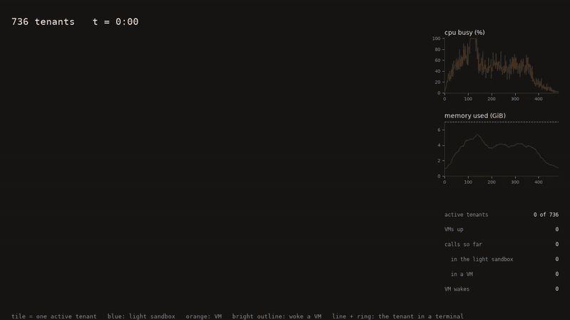

# sandroute

[](docs/videos/timelapse-736.mp4)

*736 agent tenants on one 7 GiB laptop, replayed from real sessions at 8x. Each tile is a sandbox, blue ran in the light sandbox and orange in a microVM. Click for the full-quality video.*

Sandroute is a sandbox for AI coding agents that serves many more tenants per machine than a microVM each. Commands that only touch files run in a locked-down light sandbox, and anything else runs in a Firecracker microVM that is restored from one shared snapshot, started only when a command needs it, and thrown away when it goes idle. On a 7 GiB laptop that holds 736 mostly idle agent tenants, where a plain microVM per tenant holds 48.

## Try it

You need an x86_64 Linux machine with KVM (any recent laptop or cloud VM that allows nested virtualization). The commands are for Debian or Ubuntu.

**1. Install the tools.**

```sh
sudo apt install bubblewrap e2fsprogs python3 curl git build-essential
curl --proto '=https' --tlsv1.2 -sSf https://sh.rustup.rs | sh        # Rust, then open a new shell
sudo usermod -aG kvm $USER                                              # access to /dev/kvm, then log out and in
```

**2. Get sandroute and build it.** `scripts/setup.sh` downloads Firecracker and a guest kernel and builds the VM image into `~/fcassets` (set `SANDROUTE_ASSETS` to put it elsewhere).

```sh
git clone https://github.com/RohanAdwankar/sandroute && cd sandroute
scripts/setup.sh
cargo build --release --examples --bins
```

**3. Start a sandbox from code.** This is `examples/quickstart.rs`; run it with `target/release/examples/quickstart`, or use sandroute from your own project with `sandroute = { git = "https://github.com/RohanAdwankar/sandroute" }`, `tokio` (features `full`) and `anyhow`.

```rust
use sandroute::Sandroute;

let sandbox = Sandroute::create().await?;                    // a fresh, isolated sandbox: 1 vCPU, 256 MiB (create_with sets both)
sandbox.write_file("hello.py", "print('hi')").await?;        // files live in /work
let res = sandbox.run("python3 hello.py", None).await?;      // runs in a microVM, started on demand
println!("{} (exit {}, ran in {:?})", res.stdout.trim(), res.exit_code, res.tier);
let res = sandbox.run("cat hello.py", None).await?;          // only touches files: the light sandbox, no VM
sandbox.close().await?;                                      // stops the VM, deletes the workspace
```

```
hi (exit 0, ran in Vm)
print('hi') (exit 0, ran in Light)
```

**4. Give a coding agent a sandbox.** `sandroute-mcp` is an [MCP](https://modelcontextprotocol.io) server that gives an agent the six tools coding agents use (bash, read, write, edit, glob, grep), all running in a sandbox over the current directory. With [opencode](https://opencode.ai):

```sh
npm i -g opencode-ai          # or: curl -fsSL https://opencode.ai/install | bash
cd ~/my-project
cat > opencode.json <<EOF
{
  "\$schema": "https://opencode.ai/config.json",
  "mcp": { "sandroute": { "type": "local", "command": ["/path/to/sandroute/target/release/sandroute-mcp"] } },
  "tools": { "bash": false, "read": false, "write": false, "edit": false, "glob": false, "grep": false }
}
EOF
opencode mcp list             # sandroute: connected
opencode                      # the agent now works in /work, in the sandbox, and your project files change as it edits
```

The `tools` block turns off opencode's own tools, so every command and every file edit goes through the sandbox. Files the agent writes appear in your project directory; anything it installs or runs stays inside.

**5. Start a lot of sandboxes.** The same job as the usual E2B example, a hundred sandboxes at once, each writing a file and reading it back, is `examples/hundred.rs`:

```sh
target/release/examples/hundred 100        # 0.8 s and 23 MiB: the read is a file command, so no VM
target/release/examples/hundred 100 vm     # 2.0 s and 242 MiB: the read runs in a microVM
target/release/examples/hundred 700 vm     # 18.5 s and 3.1 GiB: 700 microVMs on a 7 GiB laptop
```

## The SDK

`Sandroute` is one sandbox. Everything is async (tokio) and returns `anyhow::Result`.

| | |
|---|---|
| `Sandroute::create()` | a sandbox with a fresh, empty workspace and a VM of 1 vCPU and 256 MiB |
| `Sandroute::create_with(cpus, mem_mib)` | the same with a VM of the size you give; sandboxes of one size share one snapshot |
| `Sandroute::open(dir)` | a sandbox over an existing directory; the files appear at `/work`, and what the sandbox changes lands in `dir` |
| `run(command, cwd)` | run a shell command, returns a `RunResult` |
| `read_file`, `write_file`, `edit_file`, `glob`, `grep_files` | the file tools; they run in the light sandbox, never in a VM |
| `prewarm()` | start the VM now, when you know the next command will need one |
| `release()` | hand the VM back now instead of waiting for it to go idle |
| `close()` | stop everything and delete what `create` made; `open` never deletes your directory |

`RunResult` has `stdout`, `stderr`, `exit_code`, `tier` (`Tier::Light`, the light sandbox, or `Tier::Vm`), `reason` (why that tier), `booted` (this command started the VM) and `ms`.

**What decides where a command runs.** The command line is parsed. If every command in it is a file utility (`ls`, `cat`, `grep`, `sed`, `find` and the like) and it stays inside the workspace, it runs in the light sandbox: a fresh set of namespaces and a seccomp filter around the command, about 6 ms, no VM. Anything else (an interpreter, a compiler, `git`, a network client, `which`, a path outside the workspace) runs in a microVM. You never choose; `res.tier` and `res.reason` tell you what happened.

**The VM's life.** The first command that needs a VM starts one by restoring a snapshot taken once at setup, which takes tens of milliseconds and holds only the pages it touches (about 27 MiB). After five idle seconds the VM is released: killed if the guest holds nothing outside the workspace and `/tmp`, or snapshotted to disk if it does (a `pip install`, say). The next command that needs a VM restores it. The workspace is kept in step both ways around every VM command, so the light sandbox and the VM always see the same files.

**Isolation.** Every sandbox is its own microVM or its own set of namespaces with a seccomp filter (the Docker default profile's 299 system calls), so tenants cannot see each other or the host. The light sandbox has no network. Whether the guest has a network is set when the VM is built (`scripts/net-setup.sh`).

**More control.** `Sandroute::new(SandrouteOptions { .. })` takes your own VM backend (`MicroVm` with `VmOptions` for Firecracker or Cloud Hypervisor, or `CriVm` for Kata and gVisor), memory and vCPU sizes, the idle window, and the workspace path. 
