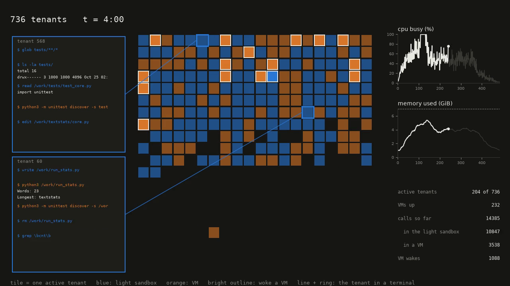
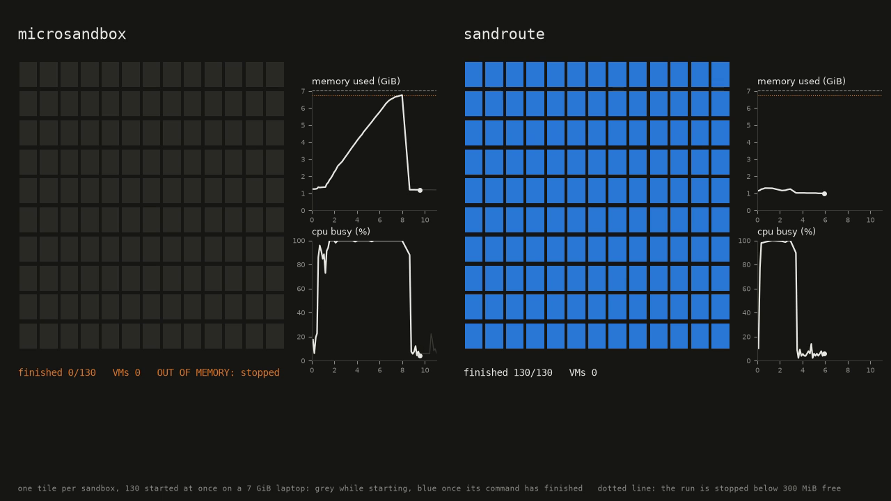

# sandroute

A sandbox for coding agents that serves many mostly idle tenants on one machine. It is a Rust library (`sandroute`), a static guest agent (`guest-agent`), and the benchmarks that measure it.

Most agent shell calls are `sed`, `grep`, `cat` and file edits. Those run in a light tier: a bubblewrap namespace with a seccomp allowlist, no VM, on the tenant's workspace. When a command needs a real machine, such as a compiler, a browser, git or the network, sandroute restores a microVM and sends it there. The VM is handed back after an idle window, and a VM that holds no state outside the workspace and `/tmp` is discarded rather than saved.

## How it routes

- The command line is parsed with tree-sitter-bash. Every command name in it is collected, including those inside `$(...)` and pipelines.
- If every name is on the light tier's list and the line touches only paths inside the workspace, it runs there.
- Anything else runs in the VM: unknown binaries, network clients, git, questions about the machine (`command -v`, `env`, `$PATH`) and absolute paths outside the workspace.
- The VM boots or restores on the first command that needs it. The workspace is host-authoritative: files are pushed in before a VM command and changes are pulled back after.

## Layout

- `src/router.rs`, `src/sandbox.rs`, `src/seccomp.rs`: routing and the light tier.
- `src/sandroute.rs`: the orchestrator (idle release, pinning while processes are alive, the file tools).
- `src/vmm.rs`: Firecracker and Cloud Hypervisor, snapshots, balloon. `src/cri.rs`: Kata and gVisor through containerd, used as comparison designs.
- `guest-agent/`: the static musl agent inside the VM. `scripts/build-rootfs.sh` builds the image; `scripts/net-setup.sh` creates the tap device (needs root once).
- `src/bin/tenants.rs`: the capacity benchmark. `src/bin/tiers.rs`: the cost of one command in each tier. `src/bin/report.rs`: a table of `bench/results`.

## See it

736 tenants on a 7 GiB laptop, replayed from real agent sessions at 8x speed: a tile per active tenant (blue ran in the light sandbox, orange in a VM, outlined woke a VM), two terminals following individual tenants (a line and a ring connect each to its tile), and cpu, memory and counts on the right.

[](docs/videos/timelapse-736.mp4)

130 sandboxes started at once, microsandbox against sandroute: microsandbox boots all 130 VMs at once, they fill the machine's memory before most have finished, and the run is stopped with 34 done, while sandroute finishes all 130.

[](docs/videos/exhaustion-130.mp4)

Both are rendered from recorded runs by `bench/timelapse.py` and `bench/compare/video.py`.

## Try it

Build the VM image once (`scripts/build-rootfs.sh`, which needs Firecracker and a kernel in `~/fcassets`, or `$SANDROUTE_ASSETS`), then:

```rust
let sandbox = Sandroute::create().await?;
sandbox.write_file("random.txt", "hello").await?;
let res = sandbox.run("cat random.txt", None).await?;   // res.stdout, res.exit_code, res.tier
sandbox.close().await?;
```

`examples/hundred.rs` does that for a hundred sandboxes at once, the same job as the usual E2B example:

    cargo run --release --example hundred 100       # 0.8 s and 23 MiB on a 7 GiB laptop
    cargo run --release --example hundred 700 vm    # 18.5 s and 3.1 GiB with every read in a microVM

Commands that only touch files run in the light sandbox, so the first run starts no VM at all; `vm` reads the file with `python3`, which does.

## Test

    cargo test
    cargo test --test vm_live -- --ignored   # boots real VMs, needs KVM and the assets in ~/fcassets

## Benchmarks

Results, method and caveats are in [docs/capacity.md](docs/capacity.md); the optimisations other providers use are in [docs/tricks.md](docs/tricks.md). The final numbers come from `bench/final/run.sh` on an otherwise idle machine.

    cargo run --release --bin tenants -- --design oxroute --tenants 64 --minutes 6
    cargo run --release --bin tiers
