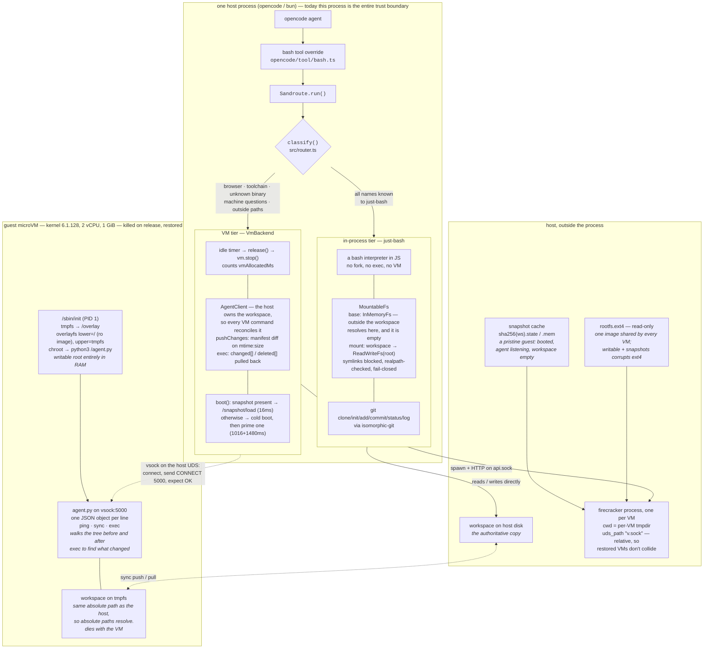

# Architecture

One tool call in, routed either to a bash interpreter running in-process or to a Firecracker
microVM that is handed back when idle.

Measured on one bare-metal KVM host. Turn latency against an agent running inside the VM:
**+1.4%**. VM allocated: **100% → 4.2%** at a 500ms idle window.

## Routing rules

| command shape | tier | why |
|---|---|---|
| every name known to just-bash | in-process | nothing needs a machine |
| browser, toolchain, network client, unknown binary | VM | just-bash cannot run it |
| `command -v`, `which`, `env`, `$PATH` | VM | the in-process shell would answer about itself |
| absolute path outside the workspace | VM | only the VM can see it |
| `git clone/init/add/commit/status/log` | in-process | isomorphic-git, no git binary |
| any other `git` subcommand | VM | not implemented in-process |

## Invariants

- **The host owns the workspace.** The guest copy is pushed in on every VM command and dies
  with the VM, which is what makes the guest disposable and the snapshot reusable.
- **Never hand a live VM to a second tenant.** Pooling is only safe as kill-and-restore from
  the pristine snapshot; the read-only image means there is no persistence path either way.
- **The rootfs is never written.** A writable root drive cannot be shared by concurrent VMs,
  and restoring a snapshot over a backing file a later VM has written corrupts the filesystem.
