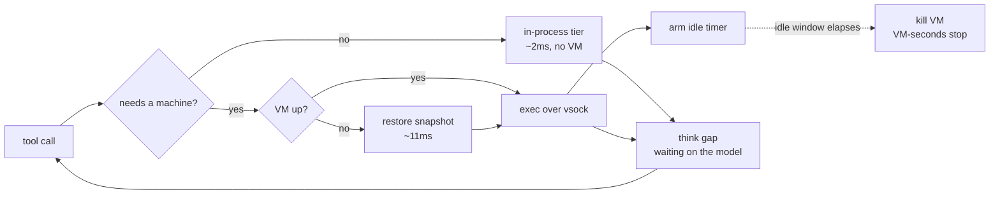

# Agents need more aggressive in-turn spin-down

Here's some notes on a thing I think agent platforms are currently paying for and
shouldn't be.

The way a cloud coding agent runs today: a user asks a question, the service allocates a
sandbox, the agent works inside it, and when the turn ends the sandbox goes away. On every
platform I've looked at, that sandbox is a microVM, and it is allocated for the *whole*
turn. Not for the parts of the turn that need a machine — the whole thing.

That used to be fine, because turns were short. They aren't anymore, and the trend is
clearly in one direction: agents run longer, make more tool calls, iterate more. If a turn
takes ten minutes, you have held a microVM for ten minutes. Scale that across a fleet and
you are paying for VMs that are, in wall-clock terms, approaching always-on.

The thing is that an agent turn barely uses the machine. It mostly reads files, greps,
edits, and then sits waiting on the model. I wanted to see what happens if you only
allocate the VM for the slices that actually need it.

- [The cost is VM-seconds, not latency](#the-cost-is-vm-seconds-not-latency)
- [Lazy boot isn't enough](#lazy-boot-isnt-enough)
- [Making wake cheap](#making-wake-cheap)
- [Releasing the VM](#releasing-the-vm)
- [Numbers](#numbers)
- [What it costs](#what-it-costs)
- [What's left](#whats-left)

## The cost is VM-seconds, not latency

First, the thing I got wrong, because it's the trap this idea invites.

My instinct was that running commands outside the VM would be *faster*. It isn't. A
microVM is not slow at running processes. Here's `bash -c 'grep -c needle f.ts'`, 200 reps,
measured inside a Firecracker guest and then on the host it's running on:

```
pure-FC per command, measured inside the guest (200 reps): 1.24ms
same loop on the host, for reference                     : 1.16ms
```

Within noise. And an in-process bash interpreter — [just-bash](https://github.com/vercel-labs/just-bash),
which is what I'm using for the light tier — lands at 1.2–2.5ms. So there is no per-command
latency to win. Not a little; none.

"VM" feels expensive because *booting* one is, and that cost gets mentally amortized across
every command inside it. But you pay a boot once and then process spawn is host speed.
Anybody selling you per-command savings from getting out of the VM is selling you nothing.

What you *can* win is the integral — how long a VM is allocated. That's the real bill, and
it's the number I'll use throughout:

```
VM-seconds per turn = ∫ (VM allocated) dt      baseline: the entire turn
```

## Lazy boot isn't enough

The obvious first move is to boot the VM lazily: start the turn with no VM, run everything
you can in-process, and only boot when a command genuinely needs a machine — a browser, a
compiler, an unknown binary, a question about the machine itself.

I built that (it's [sandroute](https://github.com/RohanAdwankar/sandroute)) and measured it
on a replayed turn: 20 tool calls, think gaps between them standing in for model latency,
4 of the 20 routed to the VM.

```
vm allocated     : 38535ms = 67.8% of the turn
vm-seconds saved : 32.2%
```

32% off. Not bad. But look at *why*: the first heavy command landed about 18 seconds into a
57-second turn, and once the VM was up it stayed up. So the saving is exactly "time until
the first heavy call":

```
saved fraction = t_first_heavy / T
```

Which goes to **zero** as turns get longer. Same trace, same code, three times the turn:

```
turn wall time   : 175881ms (repeat=3)
vm allocated     : 157577ms = 89.6% of the turn
vm-seconds saved : 10.4%
```

32% became 10%. The longer the turn, the likelier a heavy call lands early, and the more
lazy boot converges on exactly the always-on cost it was supposed to avoid. It defers the
allocation; it doesn't shorten it. Against the actual trend in agent behaviour, lazy boot
is a rounding error.

What you need is to give the VM *back* in the middle of the turn.

## Making wake cheap

The reason nobody does this is that boots are expensive. Cold boot to a guest that can
accept work, measured:

```
cold boot to agent ready : 773ms
```

Pay that every time the agent reaches for the machine and you've traded a compute bill for
a latency bill. Nobody wants that.

But Firecracker snapshots exist, and they are *absurdly* fast:

```
cold boot to agent ready : 773ms
snapshot create          : 1468ms  (1024MiB mem + 25KiB state)
snapshot restore run 1   : 11ms to agent ready
snapshot restore run 2   : 11ms to agent ready
snapshot restore run 3   : 11ms to agent ready
```

11ms. Three runs, no variance. That's a 70× difference against the cold boot, and it
completely changes what's affordable. At 11ms you can hand the VM back between tool calls
and nobody notices.

One design detail that makes this clean. The snapshot I restore is of a *pristine* guest —
booted, agent listening, workspace empty — and I take it once, before any work happens.
That works because the host owns the workspace and re-pushes it on wake, so the guest never
needs to retain anything. The VM is disposable by construction, which means one snapshot
serves every wake for the rest of the turn and I never pay the 1.5s create again.

Two things that bit me getting there:

**vsock connections don't survive a snapshot.** If you snapshot with the agent connection
open, the restored guest comes back holding a dead socket and the agent wedges. So
readiness gets probed with a throwaway connection that's closed before the pause, and the
real connection is only opened after resume.

**`uds_path` is baked into the snapshot.** Store it absolute and every restored VM fights
over the same socket file:

```
Load snapshot error: Failed to restore devices: Error restoring MMIO devices:
VsockUnixBackend: Error binding to the host-side Unix socket: Address in use (os error 98)
```

Store it *relative* and set firecracker's cwd per VM, and they coexist fine. That matters
if you want one snapshot backing many concurrent sessions, which you do.

## Releasing the VM

With wake at 11ms the policy can be blunt: after some idle window with no VM-tier command,
kill the VM. Next heavy command restores one.



The think gaps are the point. That's where a session-long VM is allocated and doing
absolutely nothing, and on a long turn it's most of the turn.

Two rules keep it honest: in-process commands don't touch the idle timer (otherwise light
work keeps a VM alive for no reason), and a command in flight blocks the release.

## Numbers

Same replayed turn, real Firecracker, 500-file workspace, sweeping the idle window:

| idle window | VM allocated | VM-seconds saved | wakes | per wake |
|---|---|---|---|---|
| none (session-long) | 67.8% | 32.2% | 1 | 70ms |
| 5000ms | 25.1% | 74.9% | 2 | 39ms |
| 2000ms | 14.7% | 85.3% | 4 | 44ms |
| 500ms | 4.2% | **95.8%** | 4 | 51ms |

And the part I actually care about — what happens as turns get longer:

| turn length | lazy boot only | idle release (2s) |
|---|---|---|
| 57s | 32.2% saved | 85.3% saved |
| 176s | 10.4% saved | 85.7% saved |

Lazy boot decays. Idle release is flat, because it isn't measuring "time before the first
heavy call" — it's measuring how much of the turn genuinely needs a machine, which doesn't
change when you make the turn longer.

At a 500ms window the VM is allocated for **4.2%** of the turn. The other 95.8% is compute
the baseline pays for and nobody uses.

## What it costs

The latency bill for all of this, at idle=2000 on the long turn: 12 wakes, 592ms total,
against a 176-second turn. **0.33%.** You are trading a third of a percent of turn latency
for 86% of your VM-seconds.

The honest caveats:

- **Wake is 11ms of VM and ~35ms of workspace sync.** Measured per-wake cost was 39–51ms
  on 500 files, and the restore is only 11–16ms of that. The rest is re-pushing the
  workspace to a pristine guest, and it scales with file count: a no-op command in the VM
  tier costs 1.7ms at 10 files, 9.4ms at 500, and 48.6ms at 3000. Frequent spin-down makes
  this a recurring bill. The fix is to stop copying — share the workspace into the guest
  with virtio-fs — at which point wake really is just the 11ms.
- **The snapshot is keyed to the workspace path**, because the guest agent's root arrives on
  the kernel command line and ends up baked into guest memory. Fine within a session. For
  cross-session sharing you'd want a canonical in-guest path.
- **The light tier's coverage decides the hit rate.** The router escalates on any unknown
  binary, so what fraction of calls stay in-process is really a statement about just-bash's
  command coverage, not about anything clever in the routing. I haven't measured that
  against real session traces, and it's the other half of the number.
- **The 11ms restore had the memory file hot in page cache**, local disk, same host.
  Firecracker's own published figure is ~125ms, which is still nowhere near 773ms.
- **My turn traces are synthetic.** The shape — mostly light calls, heavy calls clustered,
  multi-second think gaps — matches what I see agents do, but it's constructed, not
  replayed from production.
- **The in-process tier is not isolated.** It reads and writes the real workspace directly.
  "Safe stuff runs in process" is doing a lot of work in that sentence, and whether
  just-bash's command set is a real security boundary is a separate question from this one.

## What's left

The thing I'd build next is virtio-fs, because it collapses the only recurring cost in the
design and makes a 100ms idle window reasonable. After that, the interesting question is
whether the idle window should be a constant at all, or predicted — an agent that just ran
`npm test` is probably about to run it again, and an agent that just read six files is
probably going to read six more.

Pretty fun to find out the boot was never the hard part.
