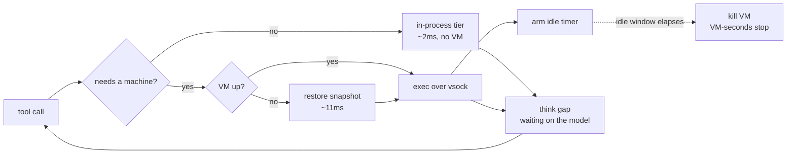

# Agents need more aggressive in-turn spin-down

A cloud coding agent holds a microVM for the whole turn and uses it for almost none of
it. The question that decides whether anything can be done about that is a single one:
**can you give the VM back between tool calls without the user noticing?**

Measured against an agent running inside the VM, same turn, same work:

| | agent inside the VM | sandroute, 500ms idle window |
|---|---|---|
| turn latency | 56253ms | 57034ms (**+1.4%**) |
| VM allocated | 56253ms (100%) | 2406ms (**4.2%**) |

Parity on what the user feels, a 24x cut in what the VM costs. The rest of this is how,
and what it actually costs.

The way a cloud coding agent runs today: a user asks a question, the service allocates a
sandbox, the agent works inside it, and when the turn ends the sandbox goes away. On every
platform I've looked at, that sandbox is a microVM, and it is allocated for the *whole*
turn. Not for the parts of the turn that need a machine — the whole thing.

That used to be fine, because turns were short. They aren't anymore, and the trend is
clearly in one direction: agents run longer, make more tool calls, iterate more. If a turn
takes ten minutes, you have held a microVM for ten minutes. Scale that across a fleet and
you are paying for VMs that are, in wall-clock terms, approaching always-on.

An agent turn barely uses the machine, though. It mostly reads files, greps, edits, and
then sits waiting on the model. The machine is needed for a browser, a compiler, a test
run — and the rest of the turn it is idle and allocated.

- [The cost is VM-seconds, not latency](#the-cost-is-vm-seconds-not-latency)
- [Lazy boot isn't enough](#lazy-boot-isnt-enough)
- [Making wake cheap](#making-wake-cheap)
- [Releasing the VM](#releasing-the-vm)
- [Parity, and what it costs](#parity-and-what-it-costs)
- [Caveats](#caveats)
- [What's left](#whats-left)

## The cost is VM-seconds, not latency

Worth being precise about what there is to win, because it isn't speed. A microVM is not
slow at running processes. Here's `bash -c 'grep -c needle f.ts'`, 200 reps, measured
inside a Firecracker guest and then on the host it's running on:

```
pure-FC per command, measured inside the guest (200 reps): 1.24ms
same loop on the host, for reference                     : 1.16ms
```

Within noise. And an in-process bash interpreter — [just-bash](https://github.com/vercel-labs/just-bash),
which is what I'm using for the light tier — lands at 1.2–2.5ms. There is no per-command
latency to win by staying out of the VM. Not a little; none. A VM feels expensive because
*booting* one is, but you pay a boot once and then process spawn is host speed.

What you can win is the integral — how long a VM is allocated. That's the bill, and it's
the number for the rest of this:

```
VM-seconds per turn = ∫ (VM allocated) dt      baseline: the entire turn
```

## Lazy boot isn't enough

The obvious first move is to boot the VM lazily: start the turn with no VM, run everything
you can in-process, and only boot when a command genuinely needs a machine — a browser, a
compiler, an unknown binary, a question about the machine itself.

That's [sandroute](https://github.com/RohanAdwankar/sandroute), measured on a replayed turn: 20 tool calls, think gaps between them standing in for model latency,
4 of the 20 routed to the VM.

```
vm allocated     : 38535ms = 67.8% of the turn
vm-seconds saved : 32.2%
```

32% off. Not bad. But look at *why*: the first heavy command landed about 18 seconds into a
57-second turn, and once the VM was up it stayed up. So the saving is exactly "time until
the first heavy call":

```
saved fraction = t_first_heavy / T
```

Which goes to **zero** as turns get longer. Same trace, same code, three times the turn:

```
turn wall time   : 175881ms (repeat=3)
vm allocated     : 157577ms = 89.6% of the turn
vm-seconds saved : 10.4%
```

32% became 10%. The longer the turn, the likelier a heavy call lands early, and the more
lazy boot converges on exactly the always-on cost it was supposed to avoid. It defers the
allocation; it doesn't shorten it. Against the actual trend in agent behaviour, lazy boot
is a rounding error.

What you need is to give the VM *back* in the middle of the turn.

## Making wake cheap

The reason nobody does this is that boots are expensive. Cold boot to a guest that can
accept work, measured:

```
cold boot to agent ready : 773ms
```

Pay that every time the agent reaches for the machine and you've traded a compute bill for
a latency bill. Nobody wants that.

But Firecracker snapshots exist, and they are *absurdly* fast:

```
cold boot to agent ready : 773ms
snapshot create          : 1468ms  (1024MiB mem + 25KiB state)
snapshot restore run 1   : 11ms to agent ready
snapshot restore run 2   : 11ms to agent ready
snapshot restore run 3   : 11ms to agent ready
```

11ms. Three runs, no variance. That's a 70× difference against the cold boot, and it
completely changes what's affordable. At 11ms you can hand the VM back between tool calls
and nobody notices.

One design detail that makes this clean. The snapshot I restore is of a *pristine* guest —
booted, agent listening, workspace empty — and I take it once, before any work happens.
That works because the host owns the workspace and re-pushes it on wake, so the guest never
needs to retain anything. The VM is disposable by construction, which means one snapshot
serves every wake for the rest of the turn and I never pay the 1.5s create again.

Two constraints come with it:

**vsock connections don't survive a snapshot.** If you snapshot with the agent connection
open, the restored guest comes back holding a dead socket and the agent wedges. So
readiness gets probed with a throwaway connection that's closed before the pause, and the
real connection is only opened after resume.

**`uds_path` is baked into the snapshot.** Store it absolute and every restored VM fights
over the same socket file:

```
Load snapshot error: Failed to restore devices: Error restoring MMIO devices:
VsockUnixBackend: Error binding to the host-side Unix socket: Address in use (os error 98)
```

Store it *relative* and set firecracker's cwd per VM, and they coexist fine. That matters
if you want one snapshot backing many concurrent sessions, which you do.

## Releasing the VM

With wake at 11ms the policy can be blunt: after some idle window with no VM-tier command,
kill the VM. Next heavy command restores one.



The think gaps are the point. That's where a session-long VM is allocated and doing
absolutely nothing, and on a long turn it's most of the turn.

Two rules keep it honest: in-process commands don't touch the idle timer (otherwise light
work keeps a VM alive for no reason), and a command in flight blocks the release.

## Parity, and what it costs

The baseline is an agent running inside the VM: the whole turn executes as one script in
the guest, so every call is a plain local spawn with no vsock hop, and the VM is allocated
for the whole turn by definition. That's the thing routing has to beat on cost without
losing on latency.

Same turn, 20 tool calls, 500-file workspace, real Firecracker:

| config | tool latency | p50 | p95 | turn | VM allocated |
|---|---|---|---|---|---|
| agent inside the VM | 150ms | 5.4ms | 27ms | 56253ms | **100%** |
| sandroute, VM kept | 746ms | 18ms | 178ms | 56808ms (+1.1%) | 67.8% |
| sandroute, 5s idle | 810ms | 18ms | 186ms | 56867ms (+1.2%) | 25.1% |
| sandroute, 2s idle | 965ms | 18ms | 179ms | 57025ms (+1.4%) | 14.7% |
| sandroute, 500ms idle | 979ms | 29ms | 167ms | 57034ms (+1.5%) | **4.2%** |

Two things to read off this.

**Per tool call, routing is clearly slower.** 979ms of tool latency against 150ms, and a
p50 of 29ms against 5.4ms. That is not parity and it would be dishonest to call it that.

**Per turn it disappears.** 829ms spread across a 56-second turn is 1.5%. A user waiting
on an agent cannot perceive it, because tool execution was never what they were waiting
for — the model was.

And the decomposition matters, because it says where the cost isn't:

```
agent inside the VM            150ms
sandroute, VM kept             746ms   +596ms   the two-tier routing
sandroute, 500ms idle          979ms   +233ms   the spin-down itself
```

**Spin-down is nearly free.** It costs 233ms and buys the drop from 67.8% to 4.2%. The
expensive part is the in-process tier — a JS bash interpreter doing a recursive grep over
500 files loses badly to native grep, and that's where the 596ms lives. Which is a
pleasant result, because it means the aggressive thing is the cheap thing.

It holds as turns get longer, which is the direction that matters:

| turn | calls | baseline | sandroute, 2s idle |
|---|---|---|---|
| 56s | 20 | 100% allocated | 14.7% allocated, turn +1.4% |
| 175s | 60 | 100% allocated | 14.3% allocated, turn +1.2% |

Compare that to lazy boot on its own, which decays from 32.2% saved to 10.4% saved over
the same two turns. Releasing the VM is flat because it isn't measuring "time before the
first heavy call" — it's measuring how much of the turn genuinely needs a machine, and
that doesn't change when you make the turn longer.

## Where the light tier earns its keep

Not in latency. A microVM spawns processes at host speed, so an in-process shell is not
beating anything -- measured above, 1.2-2.5ms against 1.24ms. What it buys is sessions
that never need a machine, and that shows up as memory.

```
one in-process session, host process      29 MiB
the same session in a microVM
  restored                               114 MiB
  after installing a dependency          208 MiB
  after a 200MiB allocation              349 MiB
  after that process exited              349 MiB
```

The last line is the point. Guest memory is never handed back: freeing it inside the VM
does nothing for the host, so a VM holds its high-water mark for the rest of its life.
A session that ran one build carries that build's peak until it goes away, which makes
releasing it the only thing that actually reclaims the memory.

That is the marginal cost of a session, with the harness left out. It does not survive
counting the harness, and the harness is most of the memory.

Measured with opencode actually launched, one process per session, each run confirmed to
have executed a tool by the file it left behind (three runs each):

```
stock opencode                       828-859 MiB   median 854
opencode with the sandroute tools    895-1097 MiB  median 927   (+73)
a restored microVM, idle             114 MiB
```

So per session, a VM each against a VM only when one is needed:

| | plain VM | sandroute | ratio |
|---|---|---|---|
| idle | 968 MiB | 927 MiB | 1.04x |
| after an install | 1062 MiB | 927 MiB | 1.15x |
| after a 200 MiB peak | 1203 MiB | 927 MiB | 1.30x |

On a 64 GiB host that is 67, 61 and 54 sessions against 70. The 4x and 12x above hold only
if sessions share one harness process, so that the marginal session costs 29 MiB and not
927; I have not measured how much a second session costs inside a single opencode server,
which is the number that decides it. With one opencode per session, the light tier is worth
a few percent at rest and about a quarter once a session has run something, because opencode
is two thirds of the footprint on both sides and the sandroute tools add about 70 MiB to it.

The earlier figure of 4x came from measuring the in-process session after the interpreter had
already been loaded, which leaves its load cost out of the per-session number. Loaded inside
each opencode process that cost is paid once per session.

Firecracker's balloon device with free-page reporting would claw some of the VM's share back
without any routing at all, which is what Meta's Muse does; that is the comparison this is
missing.

## Caveats

- **The in-process tier is where the latency goes, and it scales the wrong way.** The 596ms
  is a JS bash interpreter losing to native `grep -r` over 500 files. On a monorepo that
  gap widens, and the 1.5% with it. The honest version of the claim is "parity at this
  workspace size"; somebody should push it until it breaks.
- **Wake is ~15ms of VM and the rest is sync.** Per-wake cost measured 39-51ms on 500
  files, and the restore is only 11-16ms of it. The remainder is re-pushing the workspace
  to a pristine guest, and it scales with file count: a VM-tier no-op costs 1.7ms at 10
  files, 9.4ms at 500, 48.6ms at 3000. Frequent spin-down makes that recurring. Sharing
  the workspace in with virtio-fs instead of copying it would leave the wake at the
  restore.
- **The guest image has to be read-only.** A writable root drive cannot be shared by two
  VMs, and under snapshots it corrupts: restore a snapshot over a backing file a later VM
  has written and the guest's cached ext4 metadata no longer matches the disk. It surfaced
  as `[Errno 74] Bad message` mid-run and e2fsck found real damage. The fix is a read-only
  image with a tmpfs overlay for the writable root, which costs about 200ms of boot.
- **A snapshot is tied to one workspace path**, because the guest agent's root arrives on
  the kernel command line and ends up baked into guest memory. Fine within a session; a
  canonical in-guest path would be needed to share one across sessions.
- **The light tier's coverage decides the hit rate.** The router escalates on any unknown
  binary, so what fraction of calls stay in-process is really a statement about just-bash's
  command set. That number is unmeasured against real session traces, and it is the other
  half of this.
- **The 11ms restore had the memory file hot in page cache**, on local disk, same host.
  Firecracker's published figure is ~125ms, still nowhere near a cold boot.
- **The turn traces are synthetic.** The shape — mostly light calls, heavy calls clustered,
  multi-second think gaps — matches what agents do, but it is constructed, not replayed
  from production.
- **The in-process tier is not isolated.** It reads and writes the real workspace directly.
  Whether just-bash's command set is a real security boundary is a separate question from
  this one, and a load-bearing one.

## What's left

The thing I'd build next is snapshotting after the workspace is loaded rather than
pristine, so a wake pushes only what changed since. It is the only recurring cost in the
design, and Firecracker offers no shared filesystem to make it go away outright. After
that, the interesting question is
whether the idle window should be a constant at all, or predicted — an agent that just ran
`npm test` is probably about to run it again, and an agent that just read six files is
probably going to read six more.

The boot was never the hard part. Holding the VM through the gaps was.
